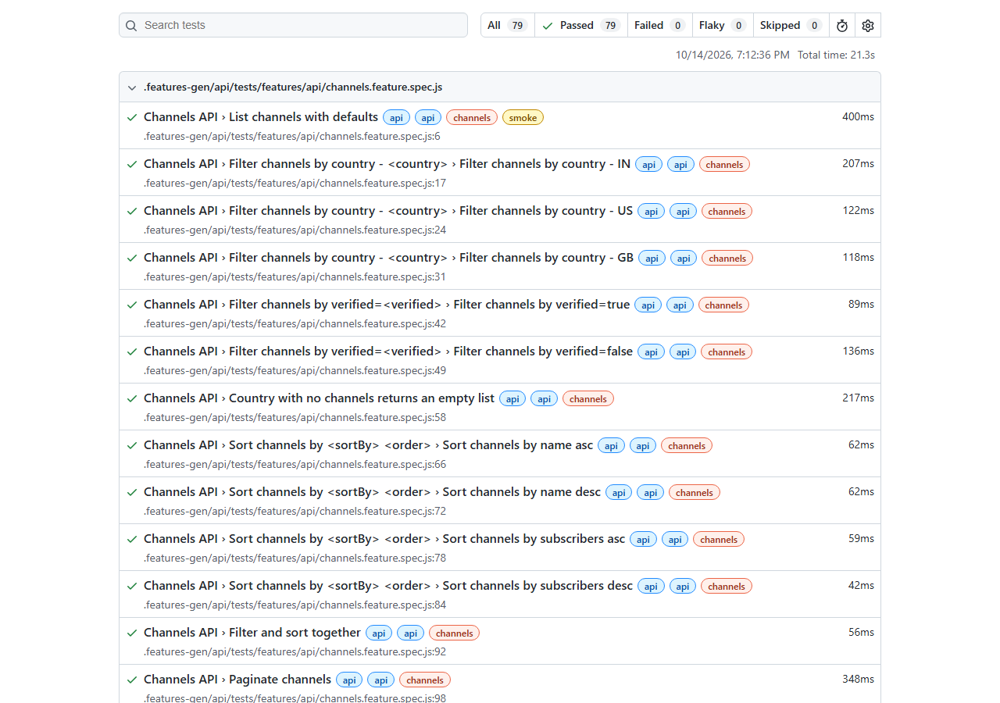
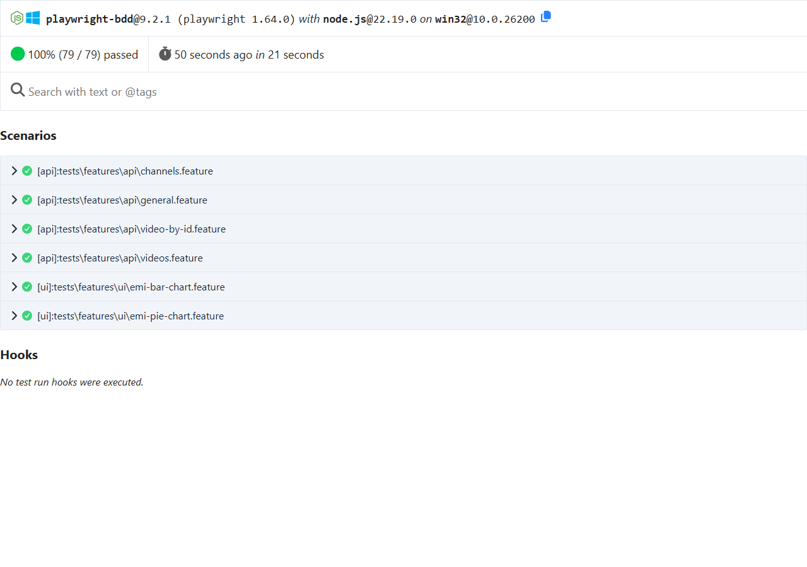

# Streamhub QA Automation Assessment - Section B

My solution for Section B (API development + API automation), plus the parts that apply to
everyone: a Playwright + Cucumber framework and the AI self-healing exercise.

- **B1** - a small Streaming Catalogue API (Express + TypeScript, mock data from JSON files)
- **B2** - Playwright + Cucumber API tests for it
- **B3** - Playwright + Cucumber UI tests for https://emicalculator.net (pie chart + bar chart test cases)
- **B4** - SQL: round-trip transfers and IPL batting streaks
- **AI self-healing** - 5 deliberately broken locators, a write-up, and a working POC

I picked Section B because testing a live third-party site (sliders, a calendar widget, charts,
ads) is closer to day-to-day QA work than testing an app I built myself, and building the API
meant I could test real validation and error handling.

## Results

| Part | What | Result |
| --- | --- | --- |
| B2 | API tests - 4 feature files | **76 / 76 passed** |
| B3 | UI tests - Test Case 1 (Scenarios A + B) and Test Case 2 | **3 / 3 passed**, 30/30 over repeated runs |
| B4 | SQL - 2 queries checked row by row against expected results | **2 / 2 match** |
| Self-healing | 5 broken locators (fail by design) healed by the POC | **5 / 5 healed and validated** (heuristic and Claude) |

`npm test`: **79 passed, 0 failed, 0 flaky** (21s). GitHub Actions runs everything on every push.

**Where the evidence is:**

| Evidence | Location |
| --- | --- |
| Playwright HTML report (traces, screenshots of every UI step) | [`reports/html/`](reports/html/) - open with `npm run report` |
| Cucumber HTML + JSON report | [`reports/cucumber/report.html`](reports/cucumber/report.html) |
| Self-healing reports | [`reports/self-healing/`](reports/self-healing/) |
| SQL output screenshots | [`sql/screenshots/`](sql/screenshots/) |





## Setup

Needs Node 22.13+ (the SQL part uses the built-in `node:sqlite`).

```bash
npm install
npx playwright install chromium
cp .env.example .env   # optional - the defaults work
```

## Running

```bash
npm test                    # API + UI tests (starts the API automatically)
npm run test:api            # API tests only
npm run test:ui             # EMI calculator tests only
npm run report              # open the last Playwright HTML report
npm run sql                 # B4: run both SQL scenarios, check results, save screenshots

npm run test:self-healing   # the 5 deliberately broken locators - these FAIL on purpose
npm run heal                # self-healing POC: detect -> suggest -> validate -> report
npm run heal -- --claude    # same, but Claude suggests the fixes (needs ANTHROPIC_API_KEY in .env)
npm run heal -- --selftest  # proves the validator rejects bad suggestions

npm run api:start           # run the API on its own on http://localhost:3000
npm run typecheck
```

## Architecture

```
feature files ──bddgen──> Playwright runner ─┬─ api project ──> ApiClient ──HTTP──> Express API (auto-started)
                                             ├─ ui project ───> EmiCalculatorPage ──> emicalculator.net (ads blocked)
                                             └─ reports: Playwright HTML, Cucumber HTML/JSON
```

**Where to find each part of the assessment**

| Assessment section | Where it lives |
| --- | --- |
| **B1** - Build an API | `api/src/` |
| **B2** - API automation | `tests/features/api/`, `tests/steps/api/`, `tests/api-clients/`, `tests/schemas/` |
| **B3** - UI test cases (EMI Calculator) | `tests/features/ui/`, `tests/steps/ui/`, `tests/pages/EmiCalculatorPage.ts`, `tests/utils/` |
| **B4** - SQL tests | `sql/` |
| **AI self-healing exercise** | `tests/self-healing/`, `tests/features/self-healing/`, `tests/steps/self-healing/`, `tests/pages/LegacyEmiCalculatorPage.ts`, `tools/self-heal/`, `docs/ai-self-healing.md` |
| **Framework** (shared by B2 + B3) | `playwright.config.ts`, `tests/fixtures/`, `tests/support/`, `.env.example` |
| **Test execution results** | `reports/`, `sql/screenshots/` |

```
api/src/                          [B1] the API
  data/                           [B1] mock "database" (videos.json, channels.json)
  routes/                         [B1] videos, channels
  lib/                            [B1] validation (zod), pagination, error handling
tests/
  features/
    api/                          [B2] API .feature files (videos, video-by-id, channels, general)
    ui/                           [B3] EMI calculator .feature files (pie chart, bar chart)
    self-healing/                 [Self-healing] feature using the deliberately broken locators
  steps/
    api/                          [B2] API step definitions
    ui/                           [B3] UI step definitions
    self-healing/                 [Self-healing] steps for the broken-locator feature
  api-clients/                    [B2] ApiClient - wraps Playwright's request context
  schemas/                        [B2] response contracts the API tests validate against
  pages/
    EmiCalculatorPage.ts          [B3] page object for emicalculator.net
    LegacyEmiCalculatorPage.ts    [Self-healing] page object with the broken locators
  utils/                          [B3] EMI formula + yearly schedule, amount parsing
  self-healing/                   [Self-healing] the 5 broken locators + their fingerprints
  fixtures/                       [Framework] wires page objects / clients / state into steps
  support/                        [Framework] env config (.env), ad blocker
tools/self-heal/                  [Self-healing] the POC (detect -> suggest -> validate -> report)
sql/                              [B4] schemas, test data, queries, runner
  results/  screenshots/          [B4] query output
docs/ai-self-healing.md           [Self-healing] the write-up
reports/                          [Results] Playwright + Cucumber reports, self-healing reports
playwright.config.ts              [Framework] projects (api, ui, self-healing), reporters, API auto-start
.github/workflows/tests.yml       [Framework] CI - runs everything on every push
```

**Framework decisions**

- **playwright-bdd** runs the Cucumber `.feature` files on the Playwright test runner, so I keep
  Gherkin and still get Playwright's HTML report, trace viewer, screenshots, retries and parallel
  workers. It also writes a Cucumber report.
- **Page Object Model** - all emicalculator.net locators and actions live in `EmiCalculatorPage`;
  steps only call its methods.
- **Fixtures** give every scenario its own page object, API client and state, so scenarios never
  share anything.
- **No hardcoded URLs** - `API_BASE_URL` and `UI_BASE_URL` come from `.env` (validated at startup,
  with defaults), and each Playwright project gets its own `baseURL`.
- **Resilient locators** - `getByLabel` / `getByRole` wherever the site has labels and roles. The
  charts and slider handles have no accessible name, so they use their stable semantic ids
  (`#emibarchart`, `#loanamountslider`). No `nth-child`, no XPath.

## B1 - API

| Method | Path | Query params |
| --- | --- | --- |
| GET | `/api/videos` | `genre`, `channelId`, `minRating` (0-5), `q` (title search), `sortBy` (title / views / rating / publishedAt), `order` (asc / desc), `page`, `limit` (1-50) |
| GET | `/api/videos/:id` | - |
| GET | `/api/channels` | `country` (2-letter code), `verified` (true / false), `sortBy` (name / subscribers), `order`, `page`, `limit` |
| GET | `/api/channels/:id` | - |
| GET | `/health` | - |

### Try it

Start the API with `npm run api:start` (runs on http://localhost:3000), then call it with curl or
just paste the URL into a browser. On Windows PowerShell use `curl.exe` instead of `curl` - plain
`curl` there is an alias for `Invoke-WebRequest`. Keep the quotes around URLs with `&` in them.

```bash
# --- health check ---
curl http://localhost:3000/health
# -> 200 {"status":"ok"}

# --- GET /api/videos : list, filter, search, sort, paginate ---
# default list: newest first, 10 per page
curl http://localhost:3000/api/videos
# -> 200 {"data":[ ...10 videos... ],"meta":{"page":1,"limit":10,"total":20,"totalPages":2}}

# filter by genre, sort by most viewed, only 2 results
curl "http://localhost:3000/api/videos?genre=music&sortBy=views&order=desc&limit=2"
# -> 200 videos 7 ("Lo-fi Beats to Study To") and 19

# search titles (case-insensitive)
curl "http://localhost:3000/api/videos?q=live"
# -> 200 2 videos: "Live Concert: Summer Festival", "Improv Night Live"

# minimum rating + pagination
curl "http://localhost:3000/api/videos?minRating=4.8&page=1&limit=5"
# -> 200 videos 13, 3 (rated 4.9) and 2 (rated 4.8)

# other filters: channelId, e.g. all videos from channel 1
curl "http://localhost:3000/api/videos?channelId=1"

# --- GET /api/videos/:id : one video ---
curl http://localhost:3000/api/videos/3
# -> 200 {"data":{"id":3,"title":"SQL Window Functions Explained", ... }}

curl http://localhost:3000/api/videos/999
# -> 404 {"error":{"code":"NOT_FOUND","message":"Video with id 999 not found","details":[]}}

curl http://localhost:3000/api/videos/abc
# -> 400 VALIDATION_ERROR, field "id"

# --- GET /api/channels : list, filter, sort, paginate ---
# default list: sorted by name A-Z
curl http://localhost:3000/api/channels

# filter by country and verified status
curl "http://localhost:3000/api/channels?country=IN&verified=false"
# -> 200 2 channels: "Byte Sized Tech", "Learn With Lina"

# top 3 channels by subscribers
curl "http://localhost:3000/api/channels?sortBy=subscribers&order=desc&limit=3"
# -> 200 "Pixel Arena", "Stadium Pass", "Laugh Track"

# --- GET /api/channels/:id : one channel ---
curl http://localhost:3000/api/channels/2
# -> 200 {"data":{"id":2,"name":"Pixel Arena","country":"US","subscribers":3400000,"verified":true}}

# --- invalid requests (400s) ---
curl "http://localhost:3000/api/videos?limit=0"        # limit must be 1-50
curl "http://localhost:3000/api/videos?gnere=music"    # unknown (typo) param -> "Unsupported parameter 'gnere'"
curl "http://localhost:3000/api/channels?country=in"   # country must be 2 uppercase letters
```

Lists return `{ data: [...], meta: { page, limit, total, totalPages } }`. Errors always look the same:

```json
{ "error": { "code": "VALIDATION_ERROR", "message": "One or more request parameters are invalid",
  "details": [{ "field": "limit", "message": "Too small: expected number to be >=1" }] } }
```

- `400` for invalid values **and for unknown query params** - a typo like `?gnere=music` would
  otherwise silently return everything and hide bugs.
- `404` for unknown ids and unknown routes, `500` never leaks a stack trace.
- A page past the end returns `200` with an empty list - it's a valid question with an empty answer.

## B2 - API tests

| Feature file | Covers | Scenarios |
| --- | --- | --- |
| `videos.feature` | defaults, all 6 genre filters, channel, minRating (incl. inclusive boundary), case-insensitive search, empty search, all 8 sort combinations, combined filters with an exact expected result, page 2 slice, page past the end, limit 1 and 50, 19 invalid params | 44 |
| `video-by-id.feature` | existing id, unknown id (404), 4 invalid ids | 6 |
| `channels.feature` | defaults, country + verified filters, empty result, sorting, filter + sort, pagination, by id, 404, 7 invalid cases | 22 |
| `general.feature` | health check, unknown routes return JSON 404 | 4 |

- Every response is checked for **status code and shape**. The shapes are zod contracts in
  `tests/schemas/`, written separately from the API's own validation - if the tests reused the
  API's schemas they'd agree with any bug in them.
- The steps are generic ("every item should have `genre` equal to `music`", "the items should be
  sorted by `views` in descending order", "the error should mention the `limit` parameter"), so most
  new tests are just a Gherkin line or an Examples row.
- **Do the tests actually catch bugs?** I planted bugs in the API one at a time. Unknown params
  being accepted failed 2 tests, pagination off by one page failed 32. But `minRating` changed from
  `>=` to `>` was caught by only one test, and only by luck - the `minRating=4.6` test checked that
  every returned item was at least 4.6, which stays true when items go missing. I added a boundary
  test that expects exactly the two videos rated 4.9, and it's now caught properly.

## B3 - UI tests (emicalculator.net)

**Test Case 1 - pie chart** (`emi-pie-chart.feature`, Scenario Outline for A and B)

- Home Loan tab, then amount / rate / tenure typed into the inputs (found by their labels).
- EMI, total interest and total payment are compared with my own calculation in
  `tests/utils/emi.ts`: 25L @ 10% / 10y = ₹33,038 and 50L @ 7.5% / 15y = ₹46,351. The site rounds the
  EMI it shows but calculates totals from the exact EMI, so the helper does the same.
- Pie chart visible, both slice values read and checked to be > 0.

**Test Case 2 - bar chart** (`emi-bar-chart.feature`)

- Personal Loan tab, then the three **sliders** are moved to 10L / 12% / 5 years: drag the handle
  to roughly the right spot, then correct with arrow keys while reading the input (a pure drag can
  land one step off because of pixel rounding). The resulting EMI (₹22,244) is checked too.
- **Calendar widget**: start month changed to Mar 2027 by stepping the year and clicking the month.
- **Bar count**: the chart is stacked - one bar per calendar year, each made of a principal and an
  interest segment - so "count the bars" could mean either. I check both: 60 months from Mar 2027
  spans 2027-2032, so **6 bars and 12 segments**. The expected count is calculated from the start
  month and tenure, not hardcoded.
- **Tooltip**: hovering the 2028 Principal and Interest bars shows ₹1,71,537 and ₹95,396 (total
  ₹2,66,933). Both are compared with my own year-by-year repayment schedule, not just "> 0".

**Other decisions**

- Ads on the site are blocked with `page.route()` - they shift the layout and can cover the sliders.
- The UI project takes a screenshot of every test, and keeps traces on failure.

## B4 - SQL

Both queries run on SQLite through Node's built-in `node:sqlite`, so there's nothing to install.
`npm run sql` checks each result row by row against the expected output and saves screenshots.
Schemas, assumptions, test data and screenshots are in **[sql/README.md](sql/README.md)**.

- **Round-trip transfers** - self-join on `transactions`; 10% measured against the original amount,
  24h and 10% limits inclusive. Test data covers exactly 10%, 11%, exactly 24h, 25h, money passed to
  a third account, a return bigger than the original, and one transfer with two returns. 7 matches.
- **IPL streaks** - window functions ("gaps and islands"): number all of a player's innings,
  number only the 30+ ones; the difference stays constant inside a streak. "Consecutive" means
  consecutive matches the player batted in, and only 2024 counts. 5 streaks.
- I broke each boundary rule in the queries on purpose (e.g. `>=` to `>`, removing the season
  filter) and the test data caught all 6.

## AI self-healing exercise

5 locators are broken on purpose - positional CSS, absolute XPath, a renamed id, stale link text,
and a Highcharts id that changes on every page load. They run in a separate `self-healing` project,
so `npm test` stays green while they stay broken.

**[docs/ai-self-healing.md](docs/ai-self-healing.md)** covers detection, the prompt approach and
validation. `npm run heal` is a working POC: it detects the broken locators, suggests a fix (a
heuristic engine by default, or Claude with `--claude`), validates each suggestion on fresh page
loads (exactly 1 element, visible, same element as before, a behaviour check), and writes a report
with a diff. It never edits code - healing can hide real bugs, so a person decides. Both engines
healed all 5, and `--selftest` shows the validator rejecting 3 deliberately wrong suggestions.

## Using Claude Code - reflection

I used Claude Code throughout, as a pair programmer rather than a code generator: I described what
I wanted and made the calls on approach and trade-offs, and it did a lot of the typing and
investigating.

**How I used it**

- Scaffolding the framework from a plain-English description (feature / step / page files, fixtures,
  config, the API).
- Inspecting the live site before writing locators - labels, slider ranges, the calendar markup,
  how the Highcharts charts are built.
- Debugging failures from Playwright's logs, screenshots and traces.
- Explaining things I wanted to be able to explain myself - the gaps-and-islands SQL pattern,
  playwright-bdd fixtures, how Highcharts renders tooltips.
- Checking my tests were meaningful - planting bugs in the API and the SQL to make sure tests fail.

**What worked**

- Speed on unfamiliar territory: Test Case 2 (sliders, a date picker, SVG charts) and the
  self-healing POC would have taken much longer on my own.
- Getting it to check reality instead of guessing. The installed packages (playwright-bdd 9,
  TypeScript 7, Zod 4, Express 5) were newer than what it knew, so I had it read the actual type
  definitions in `node_modules`, and the current Anthropic SDK docs before writing the API call.
- Debugging. When a test went flaky it found the cause from the failure screenshot: the previous
  tooltip was sitting on top of the next bar it wanted to hover.

**What didn't work / where I had to correct it**

- It assumed the chart series had `aria-label`s to find them by - they don't, because the site
  doesn't load Highcharts' accessibility module.
- It used `innerText` on SVG chart labels, which doesn't exist on SVG, so every year came back
  `undefined`.
- Its bar count came back 14 instead of 12 because the legend icons share the bars' CSS classes.
- Its first result locator matched the "Total Payment" heading exactly, but that heading has a `<br>`
  in it, so it would never have matched.
- 75/75 API tests passing first time looked too good, so I asked it to prove the tests could fail.
  That found the `minRating` boundary gap.
- Its first code was very "textbook" - doc comments on everything - so I asked for plainer code.

**Takeaway:** it's very fast, but it states wrong assumptions as confidently as right ones. What
made it useful was checking everything against the real page, the real data and the real error
messages, and asking "how do we know this test would actually fail?"

My running notes from while I was building this are in [docs/claude-code-notes.md](docs/claude-code-notes.md).

## Known limitations

- emicalculator.net is a live third-party site; if its markup or behaviour changes, the UI tests can
  break. Ads are blocked to keep runs stable, and failures keep a trace and screenshot.
- Test Case 2 uses a fixed start month (Mar 2027) so the expected bar count is deterministic.
- "Count the bars" and "consecutive matches" were open to interpretation - my choices are explained
  above and in the code.
