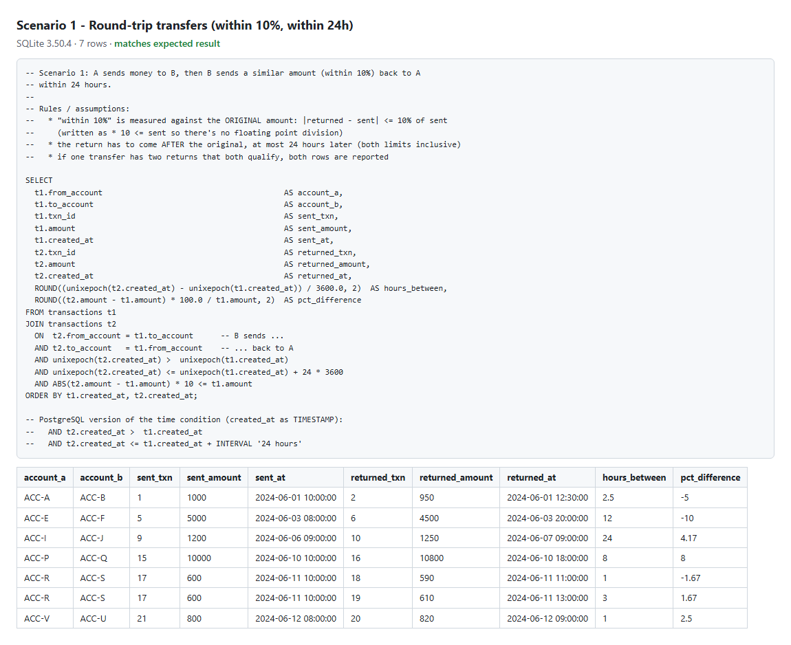
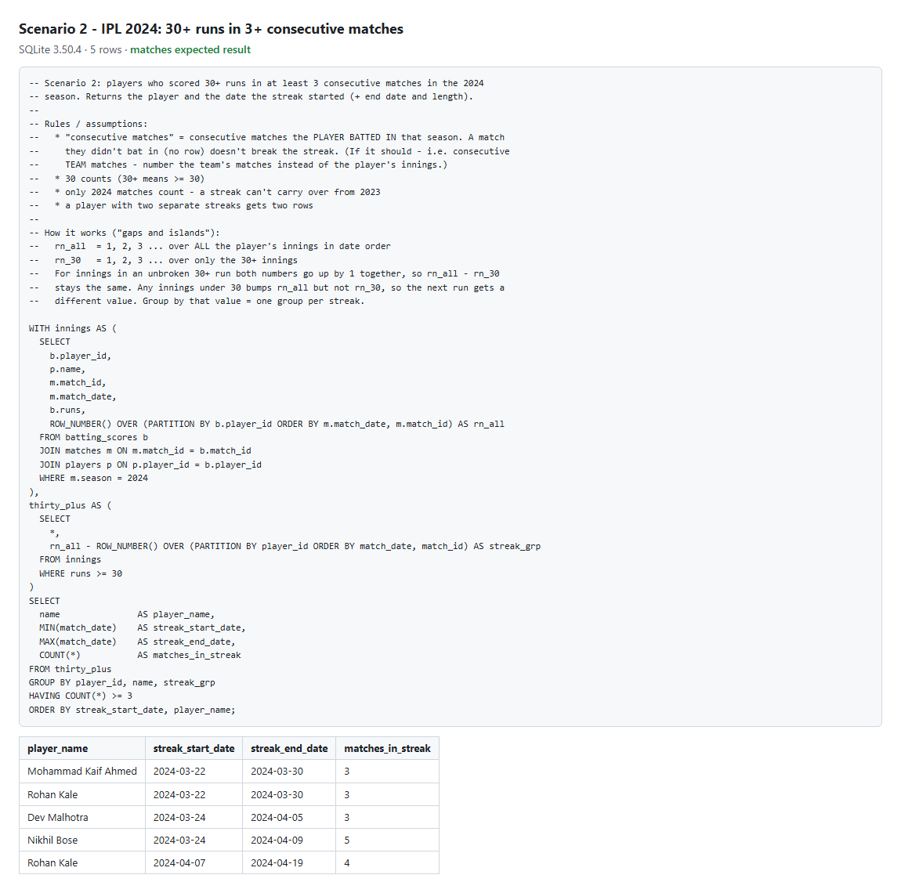

# B4 - SQL

Both scenarios run on SQLite through Node's built-in `node:sqlite`, so there's nothing to install:

```bash
npm run sql
```

That builds a fresh in-memory database per scenario (`schema.sql` + `data.sql`), runs `query.sql`,
**checks the output row by row against the expected result**, and writes
[`results/`](results/) (markdown) and [`screenshots/`](screenshots/) (PNG). The queries are standard
SQL apart from the time maths - the PostgreSQL version of that line is in a comment in the query.

```
sql/
  01_round_trip_transfers/   schema.sql, data.sql, query.sql
  02_ipl_streaks/            schema.sql, data.sql, query.sql
  run.ts                     runner + expected results
  results/  screenshots/     output
```

## Scenario 1 - Round-trip transfers

> Account A sends money to B, and B sends a similar amount (within 10%) back to A, both within 24 hours.

**Schema**

```sql
CREATE TABLE accounts (
  account_id   TEXT PRIMARY KEY,
  holder_name  TEXT NOT NULL
);

CREATE TABLE transactions (
  txn_id        INTEGER PRIMARY KEY,
  from_account  TEXT NOT NULL REFERENCES accounts(account_id),
  to_account    TEXT NOT NULL REFERENCES accounts(account_id),
  amount        NUMERIC(12, 2) NOT NULL CHECK (amount > 0),
  created_at    TEXT NOT NULL,          -- 'YYYY-MM-DD HH:MM:SS' (UTC)
  CHECK (from_account <> to_account)
);
CREATE INDEX idx_txn_from_to ON transactions (from_account, to_account, created_at);
```

**Approach:** self-join `transactions` to itself - `t1` is the original transfer, `t2` the return:
`t2.from = t1.to`, `t2.to = t1.from`, `t2` after `t1` by at most 24h, and
`|t2.amount - t1.amount| * 10 <= t1.amount` (10% without floating point division).

**Assumptions**

- 10% is measured against the original amount, and works both ways (the return can be up to 10% more or less).
- The return must come after the original. Both limits are inclusive: exactly 10% and exactly 24 hours count.
- If one transfer has two returns that both qualify, both are reported, since both are suspicious.

**Test data** - each pair checks one rule:

| Txns | Case | Expected |
| --- | --- | --- |
| 1 -> 2 | 5% less, 2.5h later | match |
| 3 -> 4 | 11% less | no |
| 5 -> 6 | exactly 10% less | match (boundary) |
| 7 -> 8 | 25 hours later | no |
| 9 -> 10 | exactly 24 hours later | match (boundary) |
| 11 -> 12 | money goes on to a third account | no |
| 13, 14 | same direction twice | no |
| 15 -> 16 | return is 8% *more* | match |
| 17 -> 18, 19 | one transfer, two returns | 2 matches |
| 21 -> 20 | the "B" side sent first | match, roles swapped |

**Result** - 7 rows, matches expected:



## Scenario 2 - IPL streaks

> Players who scored 30+ runs in at least 3 consecutive matches in the 2024 season - name and the date the streak started.

**Schema**

```sql
CREATE TABLE players (
  player_id  INTEGER PRIMARY KEY,
  name       TEXT NOT NULL,
  team       TEXT NOT NULL
);

CREATE TABLE matches (
  match_id    INTEGER PRIMARY KEY,
  season      INTEGER NOT NULL,
  match_date  TEXT NOT NULL,             -- 'YYYY-MM-DD'
  team1       TEXT NOT NULL,
  team2       TEXT NOT NULL
);

-- one row per player per match they batted in (did not bat = no row)
CREATE TABLE batting_scores (
  match_id   INTEGER NOT NULL REFERENCES matches(match_id),
  player_id  INTEGER NOT NULL REFERENCES players(player_id),
  runs       INTEGER NOT NULL CHECK (runs >= 0),
  PRIMARY KEY (match_id, player_id)
);
```

**Approach - gaps and islands with window functions:** number each player's 2024 innings in date
order (`rn_all`), then number only their 30+ innings (`rn_30`). Inside an unbroken 30+ run both
numbers go up together, so `rn_all - rn_30` stays constant; any innings under 30 changes it. Group
by that difference = one group per streak, keep groups with 3+ innings, `MIN(match_date)` is the
start date.

**Assumptions**

- "Consecutive matches" means consecutive matches the player batted in. A match where they didn't
  bat doesn't break the streak. To use consecutive *team* matches instead, number the team's
  matches rather than the player's innings.
- 30 counts (30+ means >= 30).
- Only 2024 matches count, so a streak can't carry over from 2023.
- A player with two separate streaks gets one row per streak. End date and length are included as extras.

**Test data** - fictional players, real team codes, 18 matches in 2024 + 2 in 2023:

| Player | Case | Expected |
| --- | --- | --- |
| Mohammad Kaif Ahmed | exactly 3, first score exactly 30 | 1 streak |
| Rohan Kale | two separate streaks (3 and 4) | 2 streaks |
| Vikram Iyer | a 29 breaks every run | none |
| Sanjay Rao | only pairs | none |
| Kabir Singh | 70, 65 in 2023 + 48 in 2024 - 3 only if the season filter is missing | none |
| Dev Malhotra | 35, did not bat, 40, 45 | 1 streak |
| Nikhil Bose | 5 in a row | 1 streak |
| Aakash Verma | 29 then 30 - near misses | none |

**Result** - 5 rows, matches expected:



## Checking the test data actually catches mistakes

I broke each boundary rule in the queries on purpose and made sure `npm run sql` reported a mismatch:

| Deliberate mistake | Caught by |
| --- | --- |
| 24h limit exclusive (`<` not `<=`) | txns 9 -> 10 (exactly 24h) |
| 10% limit exclusive | txns 5 -> 6 (exactly 10%) |
| return allowed before the original | every pair reported twice (14 rows instead of 7) |
| no season filter | Kabir Singh's 2023 -> 2024 "streak" appears |
| 30 not counted (`>` not `>=`) | Mohammad Kaif Ahmed's streak disappears |
| needs more than 3 (`>` not `>=`) | the three 3-match streaks disappear |

All 6 caught; queries restored afterwards.
